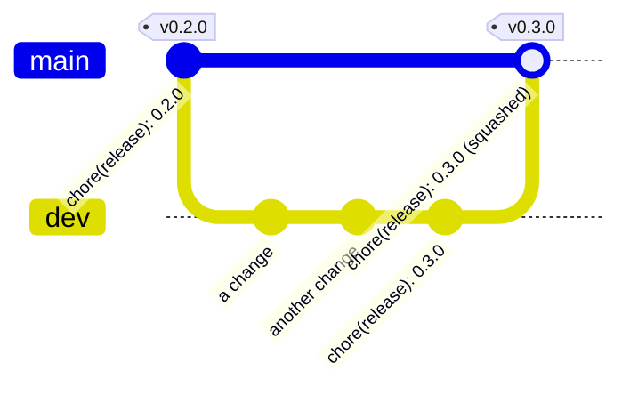

← [Documentation](docs/README.md)

# Contributing

This page gets you from a clone to a change that passes CI: setting up, running the plugin while you work on it, the tests, and how commits, branches and releases work here. For how the code fits together, read [docs/HOW_IT_WORKS.md](docs/HOW_IT_WORKS.md) first.

## Setting up

You need Windows, [Rust](https://rustup.rs/) (stable, with `rustfmt` and `clippy`, which rustup installs by default), git, and Python 3.9 or later for the commit check and the tools. There is no npm or Node.js anywhere.

```powershell
git clone https://github.com/xiaodoudou/streamdeck-helldivers2-stratagems-plugin.git
cd streamdeck-helldivers2-stratagems-plugin
git config core.hooksPath .githooks
git checkout dev
```

The third line turns on the commit-msg hook (see [The check](#the-check)).

## Running it

Build the plugin and link it into Stream Deck once:

```powershell
.\build.ps1
.\install.ps1 -Link
```

Restart the Stream Deck app after the link. From then on, each `.\build.ps1` is picked up without a restart: the script renames the running `hd2-plugin.exe` aside and copies the new one in its place, the plugin sees that its file changed and exits, and Stream Deck starts the new one within a few seconds. Don't kill the plugin to replace it: Stream Deck counts that as a crash, and disables a plugin that crashes a few times.

The plugin logs to `plugin\com.xiaodoudou.helldivers2-stratagems.sdPlugin\hd2-plugin.log` (the run before is in `hd2-plugin.prev.log`): the game's state, every loadout it reads, every key press, and a heartbeat with scan times every ten seconds.

The Stream Deck app reads `manifest.json` only when it starts. After changing an action's name, tooltip or default image, restart the app.

`hd-scanner`, the crate's second program, reads saved screenshots and times live scans without Stream Deck:

```powershell
cd scanner
cargo run --release --bin hd-scanner -- bench ..\data <frame.png or folder>   # what each row reads, and how long it takes
cargo run --release --bin hd-scanner -- live ..\data 10                       # scan the running game for 10 s and print timings
cargo run --release --bin hd-scanner -- lookalikes ..\data                     # stratagems whose icons are the same picture
```

## Tests

| Command | What it runs |
|---|---|
| `cargo test` (in `scanner/`) | The unit tests of the crate and of the plugin, including reading cropped screenshots of the game from `scanner/tests/fixtures/` |
| `python tools/commitlint_test.py` | The tests of the commit check |

The full screenshots (`data/samples/`) are not in git, as they are several megabytes each. The tests read crops of them, cut to the column the plugin captures, so they run anywhere, CI included, without the game. `tests/frames.rs` checks each crop against what the screenshot visibly shows: slots, names, statuses, fill, badges and arrow codes.

What the tests don't cover needs the game or a screen: the capture itself, the key presses, and the plugin's main loop.

Some tests are marked `#[ignore]`, with the reason. Most assert what a screenshot shows where the reader still gets it wrong today, so that fixing the reader is a matter of removing the mark; `cargo test -- --ignored` runs them and fails on purpose. Two of them are generators instead:

| Command (in `scanner/`) | What it makes |
|---|---|
| `cargo test --test frames -- --ignored --nocapture make_fixtures` | Cuts the fixtures again from `data/samples/` and checks that each crop reads like its full frame |
| `cargo test --bin hd2-plugin -- --ignored --nocapture demo_frames` | The key images of a scripted mission, drawn by the plugin's own code; then `python tools/make_demo_gif.py` (from the repository root) turns them into `docs/img/demo.gif`, the animation of the README |

| `cargo test --bin hd2-plugin -- --ignored --nocapture store_scenes demo_frames` | The keys for two real screenshots of the menu, standby and the Scan key's looks, plus the scripted mission; then `python tools/make_store_media.py` makes the Elgato Marketplace media in `dist/store/` (it needs the full screenshots of `data/samples/` and ffmpeg for the video) |

Retake the README animation and the Marketplace media when the look of the keys changes.

## What CI checks

`.github/workflows/test.yml` runs on every pull request and on `main` and `dev`:

1. that the commit messages of the push or pull request follow [Conventional Commits](#commit-messages), and that the title of a pull request into `main` does too;
2. on Windows: `cargo fmt --check`, `cargo clippy --all-targets -- -D warnings` and `cargo test`;
3. `.\build.ps1 -Package`, whose `.streamDeckPlugin` file is kept as an artifact of the run, so every pull request can be installed and tried.

Run `cargo fmt`, `cargo clippy --all-targets` and `cargo test` before you push. `scanner/rustfmt.toml` sets the line width to 140.

## Making a change

- One concern per commit, small enough to review. A refactor and a behaviour change are two commits.
- A bug fix comes with a test that fails without the fix. A reading bug usually needs a new fixture: crop the screenshot to the captured column, as the existing ones are.
- Thresholds of the matcher were tuned on real frames. Change one only with frames that show why, and run `hd-scanner bench` on the samples before and after.
- The plugin never opens the game's process or reads its memory or files, and only types into the game when it is the window in front. Keep it that way.
- Update the documentation in the same change: a new setting goes into [docs/USAGE.md](docs/USAGE.md#all-settings), a change of how the game is read into [docs/HOW_IT_WORKS.md](docs/HOW_IT_WORKS.md). [docs/README.md](docs/README.md) says which page owns which topic. Write each paragraph on one line: some Markdown viewers show every line break.
- Draw diagrams with [Mermaid](https://mermaid.js.org/) in a ` ```mermaid ` block, not as images, so they stay editable in a diff.

## Commit messages

Commit messages follow [Conventional Commits 1.0.0](https://www.conventionalcommits.org/en/v1.0.0/):

```
<type>(<scope>): <description>

<body>

<footer>
```

The title is one line of at most 100 characters, with no final period. It says what changes for the user of the plugin, in the present tense.

| Type | Use it for |
|---|---|
| `feat` | A new feature, or a change a user can see |
| `fix` | A bug fix |
| `docs` | Documentation only |
| `style` | Formatting, with no change of behaviour |
| `refactor` | A change of the code that neither fixes a bug nor adds a feature |
| `perf` | A change that makes something faster or lighter |
| `test` | Tests |
| `build` | The build scripts, the dependencies and the packaging |
| `ci` | The CI and release workflows |
| `chore` | Anything else, and releases: `chore(release): 0.2.0` |
| `revert` | A revert |

The scope is the part of the plugin the change is about, in lower case: `plugin` (the Stream Deck side and its keys), `scanner` (reading the screen: capture, matcher, status), `engine` (slot state, calling stratagems in), `input`, `icons`, `data` (the stratagem list and pictures), `tools`, `release`. Leave it out when no part fits.

```
fix(engine): keep a slot's cooldown when its row leaves the closed HUD
feat(plugin): start the game from the Scan key
docs: say which page to read for each question
ci: update actions/checkout to v7
```

A change that breaks users gets a `!` before the colon, and a `BREAKING CHANGE:` footer that says what to do about it.

The body, wrapped at about 120 characters, explains **why**: what was wrong, what the change does about it, and anything a reviewer should know (what was tried and dropped, what is left for later). The diff already says what changed line by line.

### The check

`git config core.hooksPath .githooks` points git at `.githooks`, whose `commit-msg` hook refuses a message that does not follow the rules above, with the reason. The rules are in `tools/commitlint.py`, which only needs the Python standard library. You can run it yourself:

```powershell
python tools/commitlint.py --range origin/dev..HEAD      # the commits of a branch
python tools/commitlint.py --title "fix: stop the crash" # one title
```

The hook only helps the person who has it, so CI checks the same rules on every push and pull request. Merge commits, reverts made by git and the `fixup!` commits of an autosquash are let through.

## Branches

`main` has **one commit per version**, each tagged (`v0.2.0`), and nobody pushes to it: the only way in is a release pull request. `dev` is where the work happens, with its commits as they were made. A change is a pull request against `dev`; a release is a pull request from `dev` to `main`, squashed into one commit.



## Pull requests

Open them against `dev`. Describe the problem, the change, and how you checked it: what you did in the game, with screenshots of the keys when they look different. CI must be green before review.

## Releasing

A release is a tag on `main`. Every change worth telling goes under **Unreleased** in `CHANGELOG.md`, in the same commit that makes the change. Write it for the person who uses the plugin: what they can do now, what behaves differently, what was broken.

1. **On `dev`**, a last commit titled `chore(release): 0.3.0` moves the Unreleased entries under a heading with the version and the date, adds the compare link at the bottom, and sets the version in two places: `version` in `scanner/Cargo.toml` (`0.3.0`) and `Version` in `plugin/com.xiaodoudou.helldivers2-stratagems.sdPlugin/manifest.json` (`0.3.0.0`: Stream Deck wants four numbers). CI is green.
2. Open a pull request from `dev` to `main` titled "chore(release): 0.3.0", with the new section of the changelog as its description, and **squash-merge** it. `main` gets one commit, with that title and description.
3. Tag that commit and push the tag:

```powershell
git fetch origin
git tag -a v0.3.0 -m "Helldivers 2 Stratagems 0.3.0" origin/main
git push origin v0.3.0
```

4. Bring `dev` up to date with `main`, so that the next release pull request shows only what came after. The squash commit has the same content as `dev` already has, so nothing changes in the files:

```powershell
git checkout dev
git merge -s ours origin/main -m "chore: merge release 0.3.0 from main"
git push origin dev
```

`.github/workflows/release.yml` runs when the tag is pushed, in order: a check that the tag names the version of `scanner/Cargo.toml` and `manifest.json` and is on `main`, the same jobs as on every push (which build and package the plugin), and the GitHub release with its generated notes and the `.streamDeckPlugin` file attached. A step that fails stops the next ones, so nothing is released from a red build. A tag with a prerelease suffix (`v0.3.0-rc.1`) is marked as a prerelease on GitHub.
