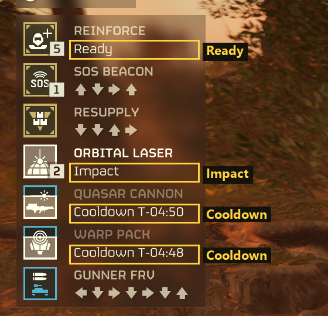
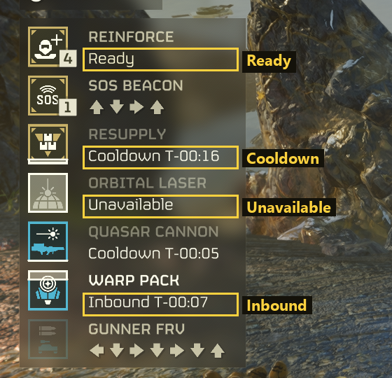
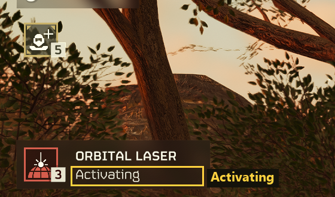

← [Documentation](README.md)

# Game languages

The plugin finds stratagems by their icon and arrow code, and those look the same in every language. The status line under each name does not. The plugin reads words like *Cooldown* or *Unavailable* by comparing them with small pictures of the words, and so far it only has English ones. With the game in another language, the keys still show your stratagems and still call them in, but they can't show cooldowns, call-ins in flight or unavailable stratagems.

Adding a language takes screenshots of six status words in that language. The plugin can't draw the words from the game's text itself, because the pictures have to match the game's font, and Chinese, Japanese and Korean use a different font altogether.

## What to capture

Set the game to your language, start a mission, and take screenshots of the stratagem panel in the top-left corner of the screen while it shows each of these words. One screenshot can show several of them.

| Word (English) | When it shows |
|---|---|
| Ready | On the Reinforce row, whenever the stratagem menu is open. |
| Cooldown | Menu open, after you call a stratagem in and it has landed. A timer follows the word. |
| Unavailable | Menu open, on a stratagem you can't call right now, for example once its uses are spent. |
| Inbound | Menu open, while a Hellpod (support weapon, backpack) is falling. A timer follows the word. |
| Impact | Menu open, while an orbital or Eagle strike is landing. |
| Activating | Just after you throw some stratagems, the Orbital Laser for one. It shows with the menu closed too. |

The [table at the end](#expected-words) gives the words to look for in each language.

## How to capture

Take a PNG screenshot. In Steam, open Settings > In Game, tick *Save an uncompressed copy*, and press F12 in the game. Windows also saves one with Win + Alt + PrtScn (the Xbox Game Bar).

Crop it to the stratagem panel, like the examples below, and keep a little margin around it. Don't resize the picture or save it as JPEG: both blur the small letters. Your screen resolution doesn't matter, because the plugin works out the scale from the size of the icons.

## Where to put them

Put the files in a folder named after your language in `languages/` (`languages/de/`, `languages/ja/`; the table gives each folder name), and name each file after the words it shows, such as `cooldown_inbound.png`. Then open a pull request, or attach the files to an issue if you'd rather not use git.

## Examples, in English

The boxes mark the status words. The rows of arrows don't matter: arrows look the same in every language.

The menu open, with Ready, Impact and two Cooldowns:

The menu open, with Ready, Cooldown, Unavailable and Inbound:

The menu closed, just after throwing the Orbital Laser, with Activating:

## Expected words

These come from the game's own text files. [languages/status_words.json](../languages/status_words.json) lists them with their string IDs. Nobody has checked them against screenshots yet, and the screenshots are how they get checked. The timer (`01:23` here) is only an example. The plugin reads its digits too, and digits look the same in every language, but where they sit after the word differs (Japanese has no `T-`, Russian puts a colon after the word), so keep the whole timer in the screenshot.

| Folder | Language | Ready | Cooldown | Unavailable | Inbound | Impact | Activating |
|---|---|---|---|---|---|---|---|
| `en` | English | Ready | Cooldown T-01:23 | Unavailable | Inbound T-01:23 | Impact | Activating |
| `fr` | French | Prêt | COMPTE À REBOURS T-01:23 | Indisponible | CONTACT T-01:23 | IMPACT | Activation |
| `de` | German | Bereit | Abklingzeit T-01:23 | Nicht verfügbar | Ankunft in T-01:23 | Einschlag | Aktivierung |
| `it` | Italian | Pronti... | T. ricarica -01:23 | Non disponibile | T. arrivo -01:23 | Impatto | Attivazione |
| `es` | Spanish (Spain) | Listo | TIEMPO DE RECUPERACIÓN T-01:23 | No disponible | LLEGADA EN T-01:23 | Impacto | ACTIVANDO |
| `es-419` | Spanish (Latin America) | Listo | Tiempo de recarga de T-01:23 | No disponible | Llegada en T-01:23 | Impacto | Activando |
| `pt` | Portuguese (Portugal) | Preparado | Tempo de recarga T-01:23 | Indisponível | A chegar em T-01:23 | Impacto | A ativar |
| `pt-BR` | Portuguese (Brazil) | Pronto | Tempo de espera T-01:23 | Indisponível | Chegando em T-01:23 | Impacto | Ativando |
| `pl` | Polish | Gotowość | Regeneracja T-01:23 | Niedostępne | Przybędzie T-01:23 | Uderzenie | Aktywowanie |
| `ru` | Russian | Готово | До перезарядки: 01:23 | Недоступно | До прибытия: 01:23 | Удар | Активация |
| `ja` | Japanese | 準備完了 | クールダウン完了まで01:23 | 使用不可 | 到着まで01:23 | 到着 | 起動中 |
| `ko` | Korean | 준비 | 쿨다운 T-01:23 | 이용 불가 | 접근 중 T-01:23 | 도착 | 작동 중 |
| `zh-Hans` | Chinese (Simplified) | 就位 | 冷却倒计时 01:23 | 不可用 | 抵达倒计时 01:23 | 着陆 | 正在启动 |
| `zh-Hant` | Chinese (Traditional) | 就緒 | 冷卻時間：01:23 | 未能使用 | 抵達時間：01:23 | 著陸 | 啟動中 |

## For maintainers

`tools/make_language_examples.py` draws the examples above from the full screenshots in `data/samples/`, which are not in git (they are several megabytes each). The word list was read offline from the game's install folder; nothing reads the game's files at run time.
